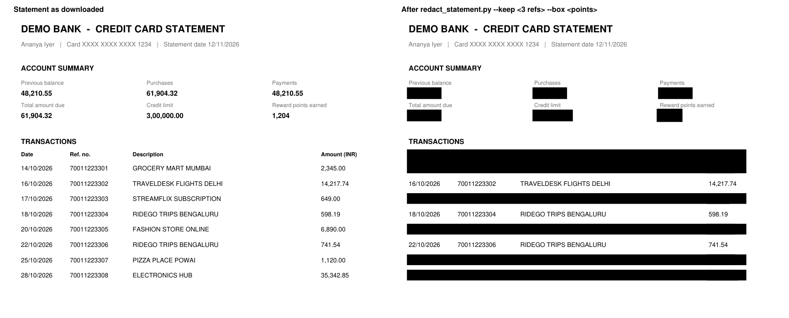
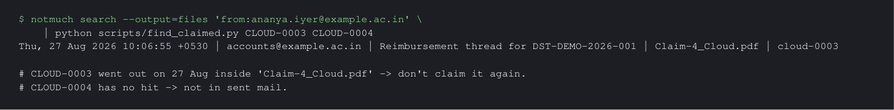
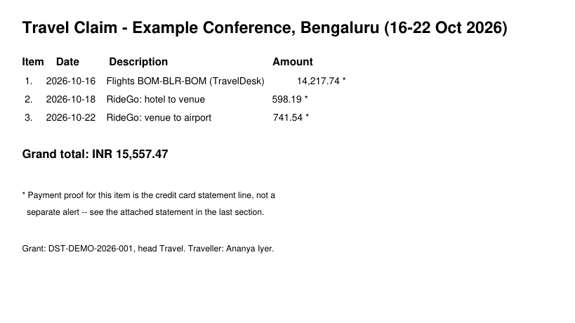
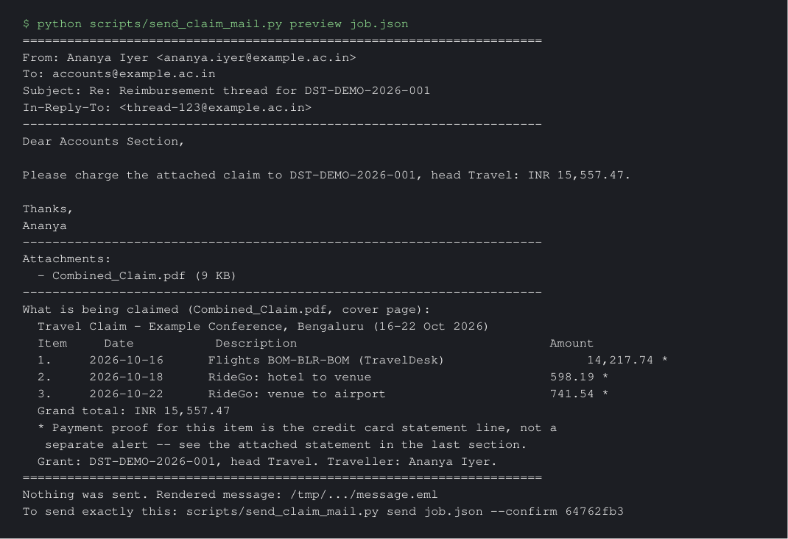

# expense-claim-prep

This repository contains a [Claude Code skill](https://docs.claude.com/en/docs/claude-code/skills). The skill prepares receipts and credit card statements for an expense claim.

The skill does these tasks:

- It finds the receipt for each transaction on a statement.
- It removes all the other transactions from the statement PDF.
- It finds missing payment alerts in your mail.
- It makes one PDF for each claim.
- It sends the claim email only after you accept a preview.

## Functions

### Find and match the documents

- The skill reads each PDF in a folder. It puts each PDF into one of three types: statement, receipt, or alert email.
- The skill can also start from your mailbox. It finds e-tickets, ride receipts, card alerts, and invoices.
- The skill keeps only the tickets with your name. It puts the tickets into groups, one group for each trip.
- The skill finds the statement line for each receipt. It compares the date, the amount, and the merchant name.
- If the statement line for a receipt is not clear, the skill tells you. Examples are two equal amounts, a charge in a foreign currency, and a partial refund.
- The skill also tells you of canceled trips, personal trips, agent fees, and invoices that do not agree with the card charge.

### Remove the other transactions

- `scripts/redact_statement.py` removes the text of all the other transactions from the PDF. It uses [PyMuPDF](https://pymupdf.readthedocs.io/).
- Most PDF tools only put a black box on the text. You can copy the text below the box. This script removes the text.
- The script also removes the account summary, for example the balances and the limits.
- After the script runs, the skill makes an image of each page. It examines the image and the text.

### Make sure that you did not claim an item before

- `scripts/find_claimed.py` reads the PDF attachments in your sent mail.
- It finds invoice numbers, PNRs, and card reference numbers in the attachments.
- A search of the email subjects is not sufficient. The subject of a claim that you sent before can be different. The file name can also be different.

### Find missing payment alerts

- If a receipt has no bank alert, the skill finds the alert in your mail.
- The skill gives you a link or a reference, not a screenshot.
- The skill uses these tools in this sequence: the Gmail connector, Apple Mail on macOS, mutt with notmuch, and a browser.
- The skill asks you for the mail account first. It does not type passwords or MFA codes.

### Make the claim documents

- `scripts/build_combined_claim.py` makes one PDF for the claim.
- The PDF has a cover page, each receipt with its payment proof, and the statement pages.
- A receipt can have more than one file, for example a ticket and its boarding passes. Images are permitted.
- You can attach only the necessary pages of a statement.
- The skill can make a claim summary from a template. You write your data in the template.
- The summary does not include bank data or tax numbers. Write these data only in the official form of your institution.

### Select a grant (optional)

- If you have data for your funds, the skill selects a grant and a budget head for each claim.
- The default rules are:
  - Use only a travel head for travel.
  - Use the money that expires first.
  - Use flexible money last.
- The skill shows the selection to you before it makes the documents.

### Send the claim email (optional)

- The template has a `claim_contacts` list. The list gives the recipients for each grant or category.
- If the list is empty, the skill can find the persons who received your claim emails before.
- `scripts/send_claim_mail.py` sends the email with mutt or neomutt.
- First, the script shows a preview. The preview shows the recipients, the text, the attachments, and the items in the claim.
- The script sends the email only with the code from the preview. If you change the email after the preview, make a new preview.
- If the mail server is not set, the script stops. It does not use the local mail queue.

## Examples

### 1. Remove the other transactions from the statement

The statement keeps only the claimed lines. Use `--box` to remove the reward points.



### 2. Find the items that you claimed before



### 3. Make one PDF for the claim



### 4. Examine the preview, then send the email



Refer to [`SKILL.md`](./SKILL.md) for the full procedure and the limits of the skill.

## Use with Claude Code

Clone this repository into your skills directory:

```bash
git clone https://github.com/saketkc/expense-claim-prep ~/.claude/skills/expense-claim-prep
```

Claude Code finds `SKILL.md` automatically. The `description` field in its frontmatter starts the skill.

An example request is *"prepare my receipts and credit card statement for an expense claim, redact everything else"*. A slash command is not necessary.

## Use with a different agent

Only Claude Code starts the skill automatically. The other parts are text and Python. Any agent can use them, and you can use them manually.

1. Give `SKILL.md` to your agent. Tell the agent to do the procedure on your folder of PDFs.
2. Run the scripts without Claude Code. The PDF scripts use Python and [`pymupdf`](https://pypi.org/project/PyMuPDF/):
   ```bash
   pip install pymupdf
   python scripts/redact_statement.py statement.pdf statement_redacted.pdf --keep 14067855696 14067601959
   # remove areas that the summary pass does not find (reward points):
   python scripts/redact_statement.py statement.pdf out.pdf --keep 11,242.45 --box 0:36,496,62,510
   python scripts/build_combined_claim.py manifest.json Combined_Expense_Claim.pdf
   # find items that you claimed before (uses pdftotext):
   notmuch search --output=files 'from:me@example.org' | python scripts/find_claimed.py INV-0004 PNR123
   # send a claim: make a preview, then send with the code from the preview
   python scripts/send_claim_mail.py preview job.json
   python scripts/send_claim_mail.py send job.json --confirm <code>
   ```
3. The step for missing alerts uses a Gmail connector, Apple Mail, mutt with notmuch, or a browser. If your agent has none of these tools, find the alert emails manually.

## Files

```
SKILL.md                                     # the procedure and the limits that the agent obeys
scripts/redact_statement.py                  # removes transactions from a statement PDF
scripts/build_combined_claim.py              # makes one PDF from the receipts and the proofs
scripts/find_claimed.py                      # finds claimed items in the attachments of sent mail
scripts/send_claim_mail.py                   # shows a preview, then sends a claim email with neomutt or mutt
examples/demo/make_screenshots.py            # makes the images in docs/img/
examples/claimant_info.example.yaml          # empty template for the claimant data and the bank data
examples/claim_manifest.example.json         # example manifest for build_combined_claim.py
```

## Limits of the redaction script

- The script finds each transaction row from the date column.
- The script keeps a row only if the row contains one of your `--keep` values.
- Use reference numbers as `--keep` values. Use exact amounts only if the statement has no reference column.
- The script finds dates in the formats `dd/mm/yyyy` and `08 Aug 26`.
- The script removes the amounts and the percentages in the account summary. It does not remove numbers without decimals, for example reward points. Use `--box` for these numbers.
- If a `--keep` value agrees with zero rows or with more than one row, the script stops. It does not save the file.
- The script cannot remove text from a scanned image.

CAUTION: Examine each page of the output before you send it. The script can make errors that you cannot see in the text.

## License

MIT. Refer to [LICENSE](./LICENSE).

## Credits

Prototyped with [claude.ai](https://claude.ai/)
